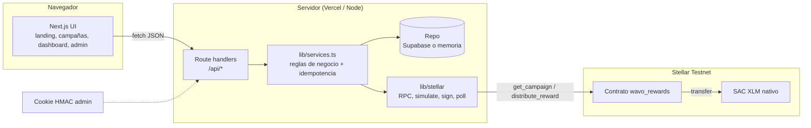

# Wavo — Content Rewards sobre Stellar

Wavo conecta marcas con creadores: la marca deposita un presupuesto en un contrato Soroban, los creadores publican contenido y cobran **solo por vistas verificadas**, a un CPM fijo, directamente en su wallet Stellar.

> MVP de hackathon. Funciona **solo en Stellar Testnet**. Las vistas se verifican manualmente por un admin (no hay oracle de redes sociales).

- Contrato en Testnet: [`CAI46OBJ2WKRIGWQRYENLXEWITNQJ7CIAWTBI4BWD7RU7FQFTPXKGKF4`](https://stellar.expert/explorer/testnet/contract/CAI46OBJ2WKRIGWQRYENLXEWITNQJ7CIAWTBI4BWD7RU7FQFTPXKGKF4)
- IDs, hashes y estado de las pruebas: [`CHECKLIST.md`](./CHECKLIST.md)
- Guion del video: [`DEMO_SCRIPT.md`](./DEMO_SCRIPT.md) · Pitch: [`PITCH_DECK.md`](./PITCH_DECK.md)

## Cómo funciona

1. **Marca**: crea la campaña (presupuesto, CPM, tope por creador) y la financia on-chain (`create_campaign` + `fund_campaign`).
2. **Creador**: se une con su dirección `G...` y envía el link de su publicación.
3. **Admin**: verifica manualmente las vistas y aprueba. El backend calcula la recompensa incremental, comprueba el saldo disponible **leído del contrato** (menos lo ya reservado) y la **reserva** en la base de datos.
4. **Pago**: el admin ejecuta `distribute_reward`; la distribución pasa a `paid` solo cuando el RPC confirma la transacción como `SUCCESS`.

Fórmula: `reward = floor((verified_views - rewarded_views) * cpm / 1000)`, limitada por `max_reward` (acumulado por creador) y por el saldo disponible. Si el saldo no alcanza, la aprobación **se bloquea** (nunca se prorratea).

Estados de una recompensa: **estimada** (vistas verificadas aún no aprobadas) → **reservada** (aprobada; fondos comprometidos en el backend) → **enviada** (tx firmada y enviada) → **pagada** (confirmada). `failed` vuelve a ser reintentable con el mismo `reward_id`; `cancelled` libera la reserva.

## Arquitectura



| Capa | Ubicación |
|---|---|
| Contrato Soroban (Rust) | `contracts/wavo_rewards/src/lib.rs`, tests en `src/test.rs` |
| Lógica de recompensas (bigint) | `lib/rewards.ts`, tests en `lib/rewards.test.ts` |
| Servicios / casos de uso | `lib/services.ts` |
| Persistencia | `lib/repo/supabase.ts`, `lib/repo/memory.ts`, `supabase/migrations/` |
| Integración Stellar | `lib/stellar/client.ts`, `lib/stellar/wavo.ts` |
| Auth admin | `lib/auth.ts` (cookie httpOnly firmada con HMAC) |
| Scripts Testnet | `scripts/01..07` |

### Contrato `wavo_rewards`

| Función | Quién firma | Qué hace |
|---|---|---|
| `initialize(admin, token)` | admin | Una sola vez. Se ejecuta en el mismo script que el deploy. |
| `create_campaign(id, owner, cpm, budget)` | owner | Registra la campaña. |
| `fund_campaign(id, from, amount)` | from | Transfiere tokens al contrato; respeta `budget`. |
| `reserve_reward(id, reward_id, amount)` | admin | Compromete fondos on-chain para un `reward_id` único (la app aún no lo usa; ver Limitaciones). |
| `release_reward(reward_id)` | admin | Libera una reserva no pagada. |
| `distribute_reward(id, reward_id, recipient, amount)` | admin | Paga una reserva o, sin reserva previa, paga desde el saldo disponible (`#8` si no alcanza). Rechaza `reward_id` repetido (`#9`). |
| `withdraw_unallocated(id, amount)` | owner | Recupera solo fondos **no comprometidos**. |
| `close_campaign(id, caller)` | owner o admin | Cierra y reembolsa lo disponible; las reservas siguen pagables. |
| `get_campaign`, `available`, `get_reward`, `admin`, `token` | — | Lecturas. |

Invariante: `available = funded - paid - refunded - reserved`. Toda la aritmética es `checked_*` con error `Overflow` explícito; hay eventos (`Funded`, `Reserved`, `Payout`, `Refunded`, `Closed`) y extensión de TTL para instancia y entradas persistentes.

### Idempotencia (dos capas)

- **Backend**: `reward_id = sha256("wavo:{campaña on-chain}:{envío}:{vistas ya pagadas}:{vistas verificadas}")`. Mismo snapshot ⇒ mismo `reward_id`. La migración tiene `unique(reward_id)` y `unique(tx_hash)`. El pago hace compare-and-set `reserved|failed → submitted`, calcula el hash **antes** de enviar y lo guarda; si el proceso muere, el siguiente intento consulta ese hash en vez de reenviar.
- **Contrato**: un `reward_id` pagado no puede volver a pagarse (`RewardAlreadyPaid`), aunque la base de datos se pierda.

## Requisitos

- Node 20+ y pnpm 8+
- Rust con target `wasm32v1-none` y [Stellar CLI](https://developers.stellar.org/docs/tools/cli) 23+ (solo para contrato y scripts)
- Opcional: proyecto Supabase

## Puesta en marcha local

```bash
pnpm install
cp .env.example .env.local     # o generarlo con los scripts de Testnet (abajo)
pnpm dev                       # http://localhost:3000
```

Sin `SUPABASE_URL`/`SUPABASE_SERVICE_ROLE_KEY` la app arranca en **modo demo en memoria**, con un banner visible: los datos se pierden al reiniciar y no se comparten entre instancias. Sin `WAVO_CONTRACT_ID`/`STELLAR_ADMIN_SECRET`, los pagos on-chain quedan deshabilitados (la UI lo indica; nunca simula transacciones).

### Desplegar el contrato y preparar Testnet

```bash
pnpm contract:test                 # 12 tests del contrato
pnpm testnet:accounts              # crea y fondea (friendbot) admin, brand, creator1, creator2
pnpm testnet:token                 # resuelve el SAC de XLM nativo
pnpm testnet:deploy                # build + deploy + initialize en un solo paso
pnpm testnet:campaign 3 1000000000 20000000   # create + fund (id, presupuesto y CPM en stroops: 100 y 2 XLM)
pnpm testnet:env                   # escribe .env.local (incluye la clave admin de Testnet)
```

Las claves de Stellar CLI quedan en `.stellar-keys/` y el estado en `.stellar-deploy.json`; ambos están en `.gitignore`.

Pago manual por CLI (útil para comprobar el contrato sin la app):

```bash
pnpm testnet:payout <campaign_id> <G...destino> <monto_en_stroops> [etiqueta]
```

Flujo completo contra la app en marcha (login admin → aprobar 20 y 15 XLM → pagar on-chain → reintentos idempotentes):

```bash
pnpm demo:flow http://localhost:3000
```

### Supabase

1. Crear el proyecto y ejecutar `supabase/migrations/20261009000000_init.sql` (SQL editor o `supabase db push`).
2. Ejecutar `supabase/seed.sql` (generado con `pnpm seed:generate` desde `lib/seed-data.ts`).
3. Añadir `SUPABASE_URL` y `SUPABASE_SERVICE_ROLE_KEY` a `.env.local` / Vercel.

RLS está activado **sin políticas**: solo el servidor (service role) accede. Las reservas/cancelaciones usan funciones plpgsql atómicas (`wavo_reserve_reward`, `wavo_cancel_reward`) concedidas solo a `service_role`.

## Variables de entorno

Todas son de servidor; ninguna es `NEXT_PUBLIC_*`. Ver [`.env.example`](./.env.example).

| Variable | Obligatoria | Uso |
|---|---|---|
| `STELLAR_NETWORK` | no (`testnet`) | Cualquier otro valor se rechaza. |
| `STELLAR_RPC_URL` | no | RPC Soroban de Testnet. |
| `WAVO_CONTRACT_ID` | para pagos | Contrato desplegado. |
| `TOKEN_CONTRACT_ID`, `TOKEN_SYMBOL`, `TOKEN_DECIMALS` | no | SAC de XLM nativo, `XLM`, `7`. |
| `STELLAR_ADMIN_SECRET` | para pagos | Firma `reserve_reward`/`distribute_reward`. **Solo Testnet.** |
| `ADMIN_PASSWORD` | sí (para /admin) | Contraseña del panel. |
| `ADMIN_SESSION_SECRET` | sí (para /admin) | ≥ 32 caracteres; firma la cookie de sesión. |
| `SUPABASE_URL`, `SUPABASE_SERVICE_ROLE_KEY` | no | Persistencia real. Sin ellas: modo memoria. |
| `DEMO_ONCHAIN_CAMPAIGN_ID` | no (`3`) | Campaña on-chain vinculada a la campaña seed. |

## Publicar en Vercel

1. Subir el repo a GitHub (sin `.env.local`, `.stellar-keys/` ni `.stellar-deploy.json`; ya están ignorados).
2. En Vercel: **Add New → Project → Import** el repositorio. Framework: Next.js (autodetectado), sin `vercel.json`.
3. En **Settings → Environment Variables** cargar las variables de la tabla anterior, marcadas como servidor (sin prefijo `NEXT_PUBLIC_`).
4. Deploy. La ruta de pago declara `maxDuration = 60` para esperar la confirmación on-chain.

Sin Supabase, Vercel funcionará en modo memoria, que es efímero y por instancia: sirve para mostrar la UI, **no** para una demo con estado fiable. Para la demo pública configurar Supabase.

## Seguridad y riesgos conocidos

- **Clave admin en el servidor**: `STELLAR_ADMIN_SECRET` firma pagos sin intervención humana on-chain. Quien la obtenga puede pagar reservas a cualquier dirección. Mitigaciones: cuenta dedicada solo de Testnet, sin fondos propios relevantes, nunca en el cliente ni en git. En producción: multisig, wallet del admin (Freighter) o un servicio de firma con límites.
- **Endpoints admin**: todos pasan por `adminRoute` (cookie httpOnly, `SameSite=Strict`, HMAC con `ADMIN_SESSION_SECRET`, comparación en tiempo constante). Sin sesión ⇒ 401.
- **Front-running de `initialize`**: mitigado al desplegar e inicializar en el mismo script; en producción usar un constructor (`__constructor`).
- **Marca sin wallet en la UI**: crear y financiar la campaña on-chain se hace por CLI (`scripts/04`) y luego se vincula desde /admin. No hay integración con Freighter en este MVP.

## Limitaciones

- Vistas verificadas manualmente por el admin; no hay APIs de redes sociales ni oracle.
- La reserva al aprobar es off-chain (base de datos), validada contra el saldo on-chain. El contrato ya soporta reservas on-chain (`reserve_reward`/`release_reward`, cubiertas por tests), pero conectar la aprobación a ellas queda como siguiente paso. Mientras tanto, el contrato impide pagar más de lo disponible (`InsufficientFunds`), pero la marca podría retirar con `withdraw_unallocated` fondos ya aprobados off-chain; el pago fallaría entonces de forma explícita, sin marcarse como pagado.
- Modo memoria: no persistente, por instancia, etiquetado en la UI.
- La integración con Supabase está implementada pero **no se probó contra una base real** (ver `CHECKLIST.md`).
- Los montos se guardan como `bigint` en Postgres y viajan por PostgREST como números JSON: seguros hasta 2^53 stroops (~900 millones de XLM).
- Token: XLM nativo vía SAC (los creadores no necesitan trustline) en lugar de un token WAVO propio.
- Una campaña on-chain cuyos `reward_id` ya se pagaron no puede repetir la demo tras reiniciar el modo memoria (el contrato lo rechaza, como debe). Para repetir: `pnpm testnet:campaign <nuevo_id>` (100 XLM, CPM 2 por defecto) y `DEMO_ONCHAIN_CAMPAIGN_ID=<nuevo_id>`.

## Calidad

```bash
pnpm test          # vitest: lógica de recompensas
pnpm lint
pnpm typecheck
pnpm build
pnpm contract:test # cargo test del contrato
```
